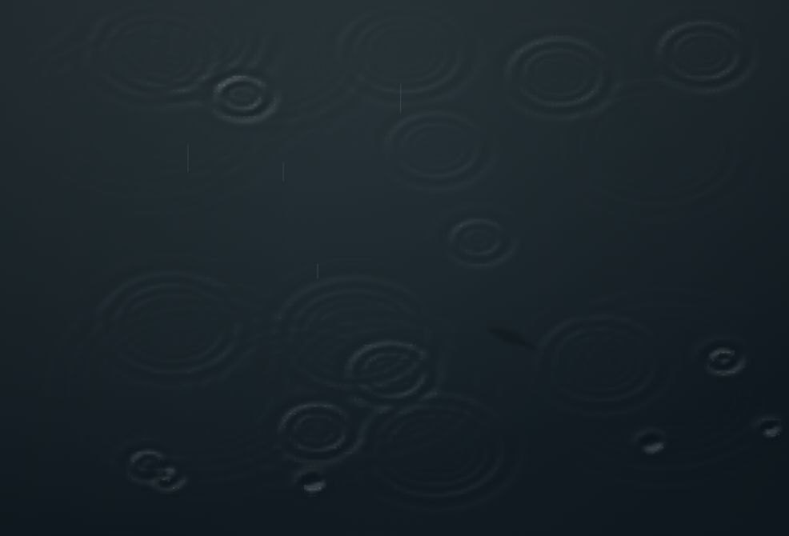
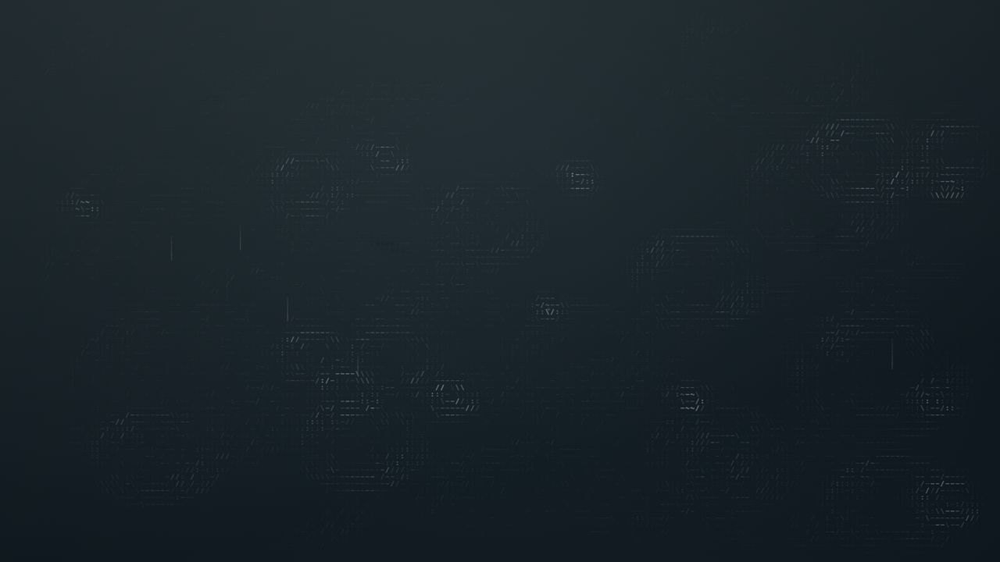

# Rain Lake

[中文完整說明](README.md#完整中文說明) · [Smooth demo](https://poplolioi11.github.io/rain-lake/smooth/) · [ASCII demo](https://poplolioi11.github.io/rain-lake/ascii/) · [Download v0.2.0](https://github.com/poplolioi11/rain-lake/releases/tag/v0.2.0)

Rain falling on a lake viewed at a 45-degree angle. Overlapping ripples reinforce or cancel one another, while slow fish shadows occasionally appear beneath the surface. The scene uses a dark gray-blue palette, fills the viewport, and has no on-screen text, controls, shoreline, or sound.

Created and art-directed by **Chen-Yu Chu (曲宸宇; [poplolioi11](https://github.com/poplolioi11))**, with AI-assisted implementation. Released under the **MIT License** for use and adaptation.

This English documentation accompanies the complete Chinese README. It introduces no new software release, dataset, performance measurement, or validation claim; the project version remains v0.2.0.

## Try it in your browser

| Version | Live demo | Frame-rate target / cap |
| --- | --- | --- |
| Smooth water | [Open Smooth](https://poplolioi11.github.io/rain-lake/smooth/) | 24 fps |
| ASCII characters | [Open ASCII](https://poplolioi11.github.io/rain-lake/ascii/) | 60 fps |

No sign-in is required. The smooth version retains soft water lighting and fine character-like marks. In the ASCII version, the ripples, rain streaks, impact points, and fish shadows use only printable ASCII characters, with a simple gradient background. Both versions share the same subject and 45-degree view.





The [v0.2.0 release](https://github.com/poplolioi11/rain-lake/releases/tag/v0.2.0) includes separate web ZIPs for the two versions. Each can be hosted independently. Source code contains the full implementation and verification scripts.

## Inspiration

The series began with the character-creature concept in [stackedlol/ascii-sharks](https://github.com/stackedlol/ascii-sharks), developed into the Eastern five-element themes and XYZ movement of [Yunlong](https://github.com/poplolioi11/yunlong), and then became the aquatic setting of [Gosanke Koi](https://github.com/poplolioi11/gosanke-koi). Rain Lake shifts the focus to rain and the lake surface.

The water, rain, and underwater silhouettes are drawn procedurally. No third-party fish, lake, or sky photographs are used. There is no rendered sky or horizon; the overcast atmosphere is expressed through dim reflections on the water.

## Run locally or host it

There are no external runtime dependencies, npm installation steps, or build steps.

```sh
git clone https://github.com/poplolioi11/rain-lake.git
cd rain-lake
python3 -m http.server 4340 --bind 127.0.0.1
```

Open [ASCII](http://127.0.0.1:4340/ascii/) or [Smooth](http://127.0.0.1:4340/smooth/). The project uses native ES modules, so serve it over HTTP or HTTPS.

For independent hosting, publish all files from either `ascii/dist/` or `smooth/dist/`. Each release web ZIP places the relevant files together; follow its included README after extracting it.

The `private: true` field in `package.json` prevents accidental npm publication. The source is still publicly licensed under MIT.

## Wave model and resources

A 45-degree orthographic projection turns circular surface waves into ellipses with a minor axis approximately 0.707 times the major axis. Raindrops perturb a two-dimensional linear finite-difference wave field with signed heights. The fields are added before calculating shading or characters, allowing reinforcement and cancellation at intersections. Absorbing boundaries and damping let the waves fade. This is an artistic simulation, not a complete fluid, weather, or optical model.

Both versions cap device pixel ratio at 1.25 and the wave field at 60,000 grid points. Rendering pauses in background tabs or when the system requests reduced motion. The web scenes can be used with wallpaper tools that support web content; the project is not a native macOS wallpaper installer.

In one hidden-browser observation on the author's Mac at 1280×720, the ASCII version recorded 2,418 frame updates over 40.298 seconds, averaging approximately 60 fps. This is a limited-environment frame-count observation, not a guarantee of stable 60 fps on every device or every frame. GPU use, total RAM use, and battery consumption inside wallpaper tools have not been measured.

## Verification and structure

Use Node.js 22 or later. No dependency installation is needed.

```sh
node scripts/check.mjs
npm test
```

Both versions include checks for a zero wave field, signed cancellation, linear superposition, decay, extreme dimensions and time steps, scene behavior, and scheduling. The ASCII version also checks that visible canvas characters remain in the printable ASCII range 32–126. Programmatic checks do not replace visual and performance checks across devices.

| Path | Purpose |
| --- | --- |
| `smooth/dist/` | Original smooth-water version, targeting 24 fps |
| `ascii/dist/` | Character-based version, targeting 60 fps |
| Each version's `dist/wave-field.js` | Signed wave field and absorbing boundaries |
| Each version's `dist/fish-shadows.js` | Underwater silhouettes and slow swimming |
| Each version's `scripts/` | Rerunnable verification |

## Use, contribute, and license

Personal wallpapers, website backgrounds, displays, teaching, research, adaptations, redistribution, and commercial use are welcome. Retain the MIT copyright and license notices. Contributions that explore different rain, water, or creatures are welcome; see [CONTRIBUTING.md](CONTRIBUTING.md).

MIT License, Copyright (c) 2026 Chen-Yu Chu (曲宸宇). See [LICENSE](LICENSE). Source attribution and the MIT notice for the original ascii-sharks project are retained in [NOTICE.txt](NOTICE.txt).

The human creator provided the subject, requirements, and artistic decisions. Codex and its assistants implemented, integrated, and verified the work; Gemini assisted with visual review of an initial version. AI collaboration does not mean all visual, physical, or performance limitations have been resolved.
